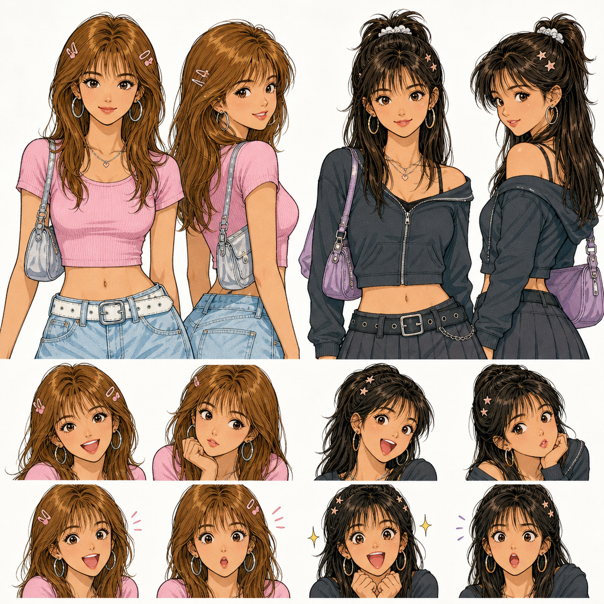
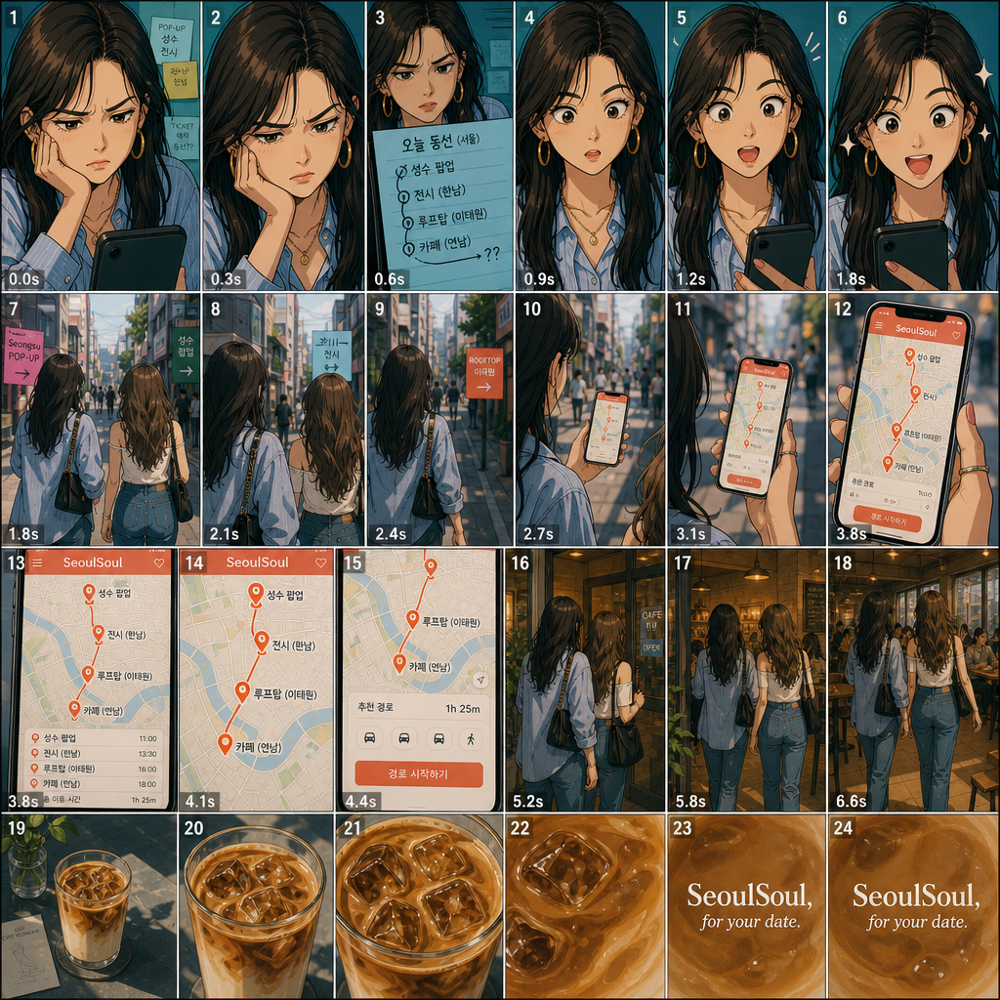
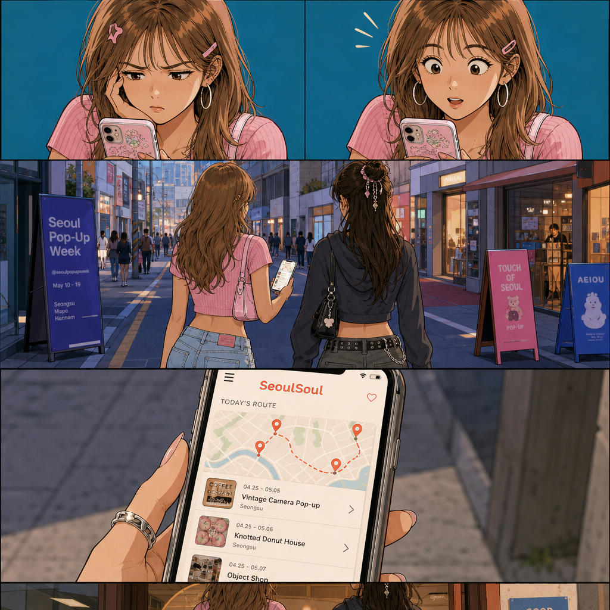
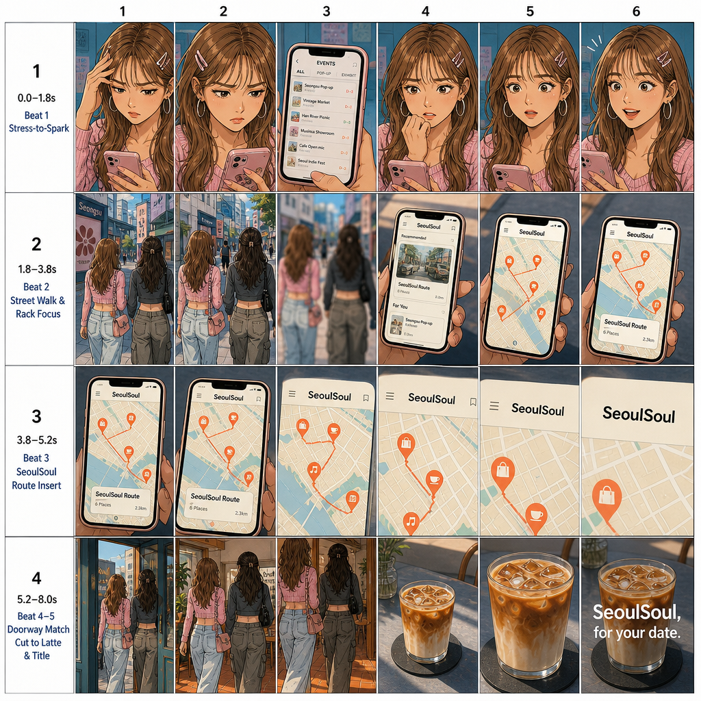

# [서비스 정체성]
* **서비스 이름:** 서울소울 (SeoulSoul)
* **한 줄 소개:** 지도 데이터와 서울 행사·이벤트 정보를 결합해, 데이트·나들이 동선을 한 번에 추천해 주는 웹 서비스
* **톤앤매너:** 다정하고 담백하게 말을 건네는 친구 같은 말투. 그림체는 90년대 레트로 애니메이션의 선화와 비율을 살리되, 색감은 누런 빈티지 필터 없이 요즘 감각의 맑고 선명한 현대적 일반 컬러와 평면 2D 셀 채색을 적용함.

---

# 1. 브랜드 아이덴티티 및 캠페인 기획

* **대상 고객(타겟):** 주말 오후 또는 평일 일과 후 데이트·나들이 동선을 짜거나 인스타그램을 일일이 검색하는 데 피로감을 느끼는 20대 커플 및 친구들
* **차별점(USP):** 지도 위 행사·팝업 정보와 이동 동선을 하나로 묶어, 여러 앱을 번갈아 검색할 필요 없이 바로 따라 걷기 좋은 완성형 서울 코스를 제안함
* **캠페인 목표:** **[인지]** — 새로운 서울 동선·행사 추천 웹 서비스 '서울소울'의 존재와 핵심 가치를 20대 타겟에게 알리기
* **핵심 메시지:** *"서울 데이트 동선 짜기는 서울소울에서"*
* **스토리라인 구조:** **[가치 전달 구조]** (동선 짜기·인스타 검색의 번거로움 공감 → 서울소울로 행사·공간·카페 동선을 한 번에 잇는 가치 전달 → 브랜드 각인)
* **규격 및 플랫폼 기준:** TikTok(틱톡) 숏폼 표준 규격 (`9:16 세로형 / 1080 x 1920 / 30fps / 총 8초`) — 과제 규격(5초 이상 10초 이내, 짧은 변 720px 이상) 충족
* **제외할 장면 및 기준:** 복잡한 앱 조작 튜토리얼이나 긴 지도 스크롤 화면은 제외함. 서비스 UI는 핵심 동선 추천 화면만 Google Stitch 기반 레퍼런스로 간결하게 인서트하여 8초 숏폼의 빠른 호흡과 애니메이션 몰입감을 유지함.

---
# 2. 사전 소재 제작 및 프롬프트 수정 기록

- **사용 도구:** GPT Image 2 (`1024x1024`, Medium 화질 통일)
- **사용 목적:** 20대 타겟에게 친근하고 힙한 인상을 주는 '갸루 스타일 여자 2인조' 캐릭터를 80년대 레트로 일러스트 선화와 맑은 현대적 일반 컬러·평면 채색으로 일관되게 구현하기 위한 기준 이미지

### ① [이미지 생성] 80년대 일러스트 감성 갸루 2인조 캐릭터 시트 레퍼런스 (GPT Image 2)
* **사용 목적:** 20대 타겟에게 친근하고 힙한 인상을 주는 '갸루 스타일 여자 2인조' 캐릭터를 80년대 레트로 일러스트 선화와 맑은 현대적 일반 컬러·평면 채색으로 일관되게 구현하기 위한 기준 이미지
* **입력 프롬프트 원문:**
```text
1980s retro Japanese city-pop and editorial magazine illustration character sheet on a clean bright off-white background, featuring two cute trendy young East Asian women in their 20s in a stylish modern gyaru look. Drawn in an authentic 1980s retro illustration style with natural human facial proportions, expressive eyes with crisp white catchlights, clean fine ink outlines, and stylish 80s pop-art sensibility—no generic modern anime default face, no exaggerated chibi proportions. Modern clean vibrant daylight colors, clear natural color palette, clean flat color fills with subtle retro print-style shading, no 3D glossy rendering, no glowing bloom, no vintage yellow filter, no dusty grain. Trendy contemporary gyaru 20s fashion: Girl A has warm honey-brown layered hair with face-framing bangs, cute hair clips, hoop earrings, wearing a fitted cropped baby-pink knit top, low-rise wide light-wash denim jeans, and a mini shoulder bag; Girl B has glossy dark-brown hair in a playful half-up style with accessories, wearing a cropped charcoal zip-up hoodie or off-shoulder top, pleated mini skirt or wide cargo pants, and a cute mini bag. Include chest-up front view, three-quarter view, and 4 expressive gyaru reactions (bright playful smile, curious tilted head, excited sparkling eyes, surprised cute look). Clean 1980s retro illustration, no text, no watermark.
```


---

### ② 슛리스트 프롬프트 수정 전후 비교 기록 (의도 미달 개선 사례)
#### 수정 대상: 8초 멀티씬 스토리보드 시트 이미지 생성 프롬프트 (v1 → v2 → v3)

### 무엇을 왜 변경했는가
1. **레퍼런스 미첨부 환경 대응 (v1 → v2)**: 이미지 레퍼런스를 첨부하지 않고 생성할 경우 캐릭터 외형과 의상이 달라지는 문제를 막기 위해, Girl A·Girl B의 헤어스타일과 착장 디테일을 프롬프트 본문 안에 명시적으로 고정함.

2. **프롬프트 길이 절삭 오류 해결 (v2 → v3)**: v2 프롬프트가 3,000자를 초과하면서 뒷부분(씬 4~5 및 엔딩 타이포그래피 지시)이 잘리는 현상이 발생함. 핵심 연출 키워드(Vertigo 줌, 맥도나 스타일 트래킹, 랙 포커스, 보색 대비, 세이프존)는 유지하되 중복 수식어를 압축하고 4 rows x 6 columns grid 레이아웃 지시를 추가하여 전체 시퀀스가 온전히 출력되도록 개선함.

---

### v1 Ready-to-Use 8-Second Video Prompt (Sora 2 / Runway / Kling)

Keep your **1980s retro city-pop / editorial magazine illustration** style and your **two gyaru characters** locked as image references, then run this unified prompt:

```text
Continuing in the exact same 1980s retro Japanese city-pop and editorial magazine illustration style as the attached reference image, featuring the same two trendy young East Asian gyaru women in their 20s with clean fine ink outlines, expressive eyes with crisp white catchlights, modern clean daylight colors, clear natural color palette, and flat color fills with subtle retro print shading—no 3D glossy rendering, no vintage yellow filter, and no dusty grain. A fast-paced, cinematic 9:16 vertical 8-second marketing reel composed with strict social media safe-zone framing (keeping all faces, phone UI, and final text centered away from the bottom caption area and right-side UI icons):

[0.0-1.8s] Dolly-out combined with simultaneous zoom-in (Vertigo dolly-zoom effect) on a tight medium close-up of one gyaru girl feeling stressed while planning a complex Seoul event route; her expression shifts quickly from furrowed-brow irritation to a sudden wide-eyed surprised spark, framed against cool teal-blue background tones for high emotional contrast.

[1.8-3.8s] Martin McDonagh-style handheld rear tracking shot following behind both gyaru friends walking briskly along a lively Seoul street lined with pop-up event spots; starting focused on their backs and layered hair, the lens executes a smooth rack focus onto the smartphone held in hand, drawing viewer attention directly to the screen.

[3.8-5.2s] Direct cut to the smartphone screen displaying the SeoulSoul route-planning interface with warm coral-orange map pins connecting the events; a subtle slow bottom-to-top boom movement paired with a gentle push-in clearly reveals the SeoulSoul app header.

[5.2-6.6s] Dynamic hip-level movement match cut continuing the forward momentum behind the two girls as they step into a sunlit cafe doorway with a natural pass-by camera motion, transitioning from cool exterior shadows into warm amber-orange interior light.

[6.6-8.0s] Smooth zoom down onto an iced latte glass placed on a cool slate cafe table; diving into the warm caramel-amber coffee surface, clean minimalist typography fades in at dead center reading "SeoulSoul, for your date." Crisp 2D illustration motion, clean typography only on the final frame, no watermark.
```


--- 

### v2 Ready-to-Use 8-Second Video Prompt (No Image Reference Required)

Because no image reference is attached, the full 1980s retro city-pop editorial illustration aesthetic, natural human proportions, and both gyaru characters are explicitly defined inside the prompt below:

```text
Rendered in an authentic 1980s retro Japanese city-pop and editorial magazine illustration style with natural human facial proportions, expressive eyes with crisp white catchlights, clean fine ink outlines, and stylish 80s pop-art sensibility—no generic modern anime default face, no exaggerated chibi proportions, no 3D glossy rendering, no glowing bloom, no vintage yellow filter, and no dusty grain. Color palette uses modern clean vibrant daylight colors, clear natural color tones, and clean flat color fills with subtle retro print-style shading. Features two cute trendy young East Asian gyaru women in their 20s: Girl A has warm honey-brown layered hair with face-framing bangs, cute hair clips, hoop earrings, wearing a fitted cropped baby-pink knit top, low-rise wide light-wash denim jeans, and a mini shoulder bag; Girl B has glossy dark-brown hair in a playful half-up style with accessories, wearing a cropped charcoal zip-up hoodie, wide cargo pants, and a cute mini bag. Composed as a fast-paced 9:16 vertical 8-second marketing reel with strict social media safe-zone framing (keeping all faces, phone UI, and final text inside the center safe zone away from the bottom caption area and right-side UI buttons):

[0.0-1.8s] Dolly-out combined with simultaneous zoom-in (Vertigo dolly-zoom effect) on a tight medium close-up of Girl A looking stressed over messy event tabs on her phone; her expression shifts quickly from furrowed-brow irritation to a wide-eyed surprised spark against a cool teal-blue background for emotional contrast, face centered in the upper-middle safe zone.

[1.8-3.8s] Martin McDonagh-style handheld rear tracking shot following behind Girl A and Girl B walking briskly past Seoul pop-up event spots; starting on their backs and layered hair with cool blue-violet street shadows shifting toward warm shopfronts, the lens performs a smooth rack focus onto the phone held at their side, framed left-of-center to clear right-side UI icons.

[3.8-5.2s] Direct cut to the smartphone screen displaying the SeoulSoul route map with warm coral-orange pins connecting events; a slow bottom-to-top boom with a subtle push-in reveals the SeoulSoul header cleanly inside the center safe zone.

[5.2-6.6s] Hip-level movement match cut continuing the forward momentum behind Girl A and Girl B as they step through a sunlit cafe doorway with a natural pass-by motion, shifting from cool exterior shadows into warm amber-terracotta interior light.

[6.6-8.0s] Smooth macro zoom down onto an iced latte glass placed on a cool slate table; diving into the warm caramel-amber coffee surface, clean minimalist text fades in dead-center reading "SeoulSoul, for your date." Crisp 2D 1980s editorial illustration motion, clean typography only on the final frame, no watermark.
```


---

### v3 이미지 생성 프롬프트가 3000자를 넘으면 잘리는 현상이 있어 더 짧은 프롬프트로 변경 / 길이 최적화 및 4x6 그리드 구조화


```text
Authentic 1980s retro Japanese city-pop and editorial magazine illustration style with natural human proportions, expressive eyes with crisp white catchlights, clean fine ink outlines, and 80s pop-art sensibility—no generic modern anime face, no chibi proportions, no 3D glossy shading, no bloom, no vintage yellow filter, no dusty grain. Clean vibrant daylight colors and flat color fills with subtle retro print shading. Two trendy young East Asian gyaru women in their 20s: Girl A has warm honey-brown layered hair, face-framing bangs, hair clips, hoop earrings, cropped baby-pink knit top, low-rise wide light-wash jeans, mini shoulder bag; Girl B has glossy dark-brown half-up hair with accessories, cropped charcoal zip-up hoodie, wide cargo pants, mini bag. Structured on a 4 rows by 6 columns grid (4 rows x 6 columns grid layout) with explicit scene allocation across an 8-second 9:16 vertical reel using strict safe-zone framing (faces, UI, and final text centered clear of bottom captions and right-side icons):

[0.0-1.8s | Scene Allocation: Beat 1 Stress-to-Spark] Vertigo dolly-out + zoom-in tight MCU on Girl A stressed over messy event tabs, shifting to wide-eyed surprise against cool teal-blue tones, face in upper-middle safe zone.

[1.8-3.8s | Scene Allocation: Beat 2 Street Walk & Rack Focus] McDonagh-style handheld rear tracking behind Girl A and Girl B walking briskly past Seoul pop-up spots, rack-focusing from hair/backs to phone screen, framed left-of-center.

[3.8-5.2s | Scene Allocation: Beat 3 SeoulSoul Route Insert] Cut to phone screen showing SeoulSoul route map with warm coral-orange pins; slow bottom-to-top boom + gentle push-in reveals SeoulSoul header in safe zone.

[5.2-6.6s | Scene Allocation: Beat 4 Doorway Match Cut] Hip-level movement match cut behind Girl A and Girl B stepping through sunlit cafe doorway, shifting cool exterior shadows into warm amber-terracotta light.

[6.6-8.0s | Scene Allocation: Beat 5 Latte Zoom & Title] Smooth zoom into iced latte on cool slate table; clean minimalist text fades in dead-center reading "SeoulSoul, for your date." Crisp 2D 1980s editorial motion on a 4 rows x 6 columns grid with scene allocation, final-frame text only, no watermark.
```



---
---


# 3.씬별 상세 스토리보드 | Director's 8-Second Shot Breakdown (9:16 Reels / TikTok)


| Timecode | Camera & Lens Technique | Visual Action & Character Beat | Color Contrast & Safe-Zone Framing |
| :--- | :--- | :--- | :--- |
| **0.0s – 1.8s** | **Dolly-Out + Zoom-In (Vertigo Effect)**<br>Tight medium close-up, subtle lens compression warp | One gyaru friend stares at messy event notes/tabs on her phone—expression shifts from **stressed, brow-furrowed irritation** to a sudden **wide-eyed surprised spark** as she finds the solution. | **Cool teal/cobalt background** vs. warm skin tones to heighten planning anxiety. Face centered in the upper-middle safe zone. |
| **1.8s – 3.8s** | **Martin McDonagh-Style Handheld Rear Tracking + Rack Focus**<br>Follows behind the two gyaru girls walking past Seoul event spots | Camera tracks behind their backs at shoulder/hip level as they walk briskly past pop-up booths. Smooth, deliberate **rack focus** pulls attention off their backs/hair onto the **phone screen** held at their side. | Natural daylight with **cool blue-violet street shadows** transitioning toward warm shopfronts. Subject kept left-of-center to clear right-side Reels icons. |
| **3.8s – 5.2s** | **Screen Insert: Slow Bottom-to-Top Boom + Subtle Push-In** | Cut directly to the smartphone screen displaying the **SeoulSoul** map route connecting the event spots. A slow upward boom and gentle push-in reveal the clean **SeoulSoul** header and optimized route. | Crisp daylight UI accented with **warm coral-orange route pins** against cool map tones. UI header sits safely below the top status bar and above the bottom caption zone. |
| **5.2s – 6.6s** | **Movement Match Cut (Hip-Level Pass-By)** | Matching the push-in momentum, the camera drops to **hip level** behind the two girls as they walk through a sunlit cafe/event doorway, creating a natural pass-by wipe into the interior. | **Complementary shift:** cool exterior shadows give way to **warm amber-terracotta interior light** as stress resolves into ease. |
| **6.6s – 8.0s** | **Audio Match Cut + Macro Zoom into Latte** | *SFX: Crisp clink of an iced latte glass set onto a table* bridges the cut. Camera zooms smoothly down into the swirling crema/latte surface where clean text resolves: **"SeoulSoul, for your date."** | Rich **warm caramel/amber latte tones** paired with a subtle cool slate tabletop for maximum contrast. Text locked dead-center inside the 9:16 safe zone. |


> **연출 핵심:** 보색 대비(스트레스 구간의 차가운 청록/블루 톤 ↔ 해결·카페 구간의 따뜻한 앰버/테라코타 톤)와 숏폼 세이프존(상·하단 및 우측 UI 아이콘 여백 확보)을 전 씬에 일관 적용함.

### [씬 1]
- **씬 번호:** 1 (0.0s – 1.8s)
- **씬 길이:** 1.8초
- **목표 메시지:** 여러 행사와 데이트 동선을 일일이 짜는 번거로움과 스트레스 공감
- **화면 구성:** Girl A의 타이트 미디엄 클로즈업(MCU). 스마트폰 속 복잡한 행사 탭을 보며 미간을 찌푸린 짜증 섞인 표정에서 해결책을 발견한 듯 눈이 커지는 놀란 표정으로 전환. **달리 아웃 + 줌 인(Vertigo 효과)**과 차가운 청록(Teal-Blue) 배경 보색 대비로 심리적 압박감 극대화. 얼굴은 상단-중앙 세이프존에 배치.
- **내레이션:** (무음 — BGM 인트로 비트 시작)
- **사용 도구:** 텍스트(Gemini), 이미지(GPT Image 2), 영상(Sora 2), 오디오(Suno)
- **사용 목적:** 스토리보드 문안(Gemini), 캐릭터 시트 및 샷 레퍼런스(GPT Image 2), Vertigo 카메라 모션 구현(Sora 2), 80년대 시티팝 비트 BGM 생성(Suno)
- **입력 프롬프트 원문:** `[영상 생성]` `Dolly-out combined with simultaneous zoom-in (Vertigo dolly-zoom effect) on a tight medium close-up of Girl A stressed over messy event tabs, shifting to wide-eyed surprise against cool teal-blue tones, face in upper-middle safe zone.` (전체 통합 프롬프트는 섹션 2의 v3 참조)
- **출력 결과 요약:** 표정 변화와 줌 압축 효과가 1.8초 안에 선명하게 구현됨
- **생성 결과 파일명:** `assets/ShotList3.png`, `광고_서울소울.mp4` (통합 클립 0.0–1.8s 구간)

### [씬 2]
- **씬 번호:** 2 (1.8s – 3.8s)
- **씬 길이:** 2.0초
- **목표 메시지:** 서울의 다양한 팝업·행사 스팟을 헤매지 않고 동선대로 이동하는 모습 제시
- **화면 구성:** 서울 팝업 스토어 거리를 경쾌하게 걷는 갸루 친구 2명(Girl A, Girl B)의 등 뒤를 쫓는 **마틴 맥도나 스타일 핸드헬드 리어 트래킹 샷**. 초반에는 두 인물의 뒷모습과 헤어에 초점을 맞추다 부드러운 **랙 포커스(Rack Focus)**로 손에 든 스마트폰 화면으로 시선을 유도함. 우측 릴스 아이콘을 피해 좌측-중앙 프레이밍.
- **내레이션:** (없음 — 경쾌한 시티팝 BGM 유지)
- **사용 도구:** 텍스트(Gemini), 이미지(GPT Image 2), 영상(Sora 2), 오디오(Gemini 4o Mini TTS)
- **사용 목적:** 카메라 트래킹 및 랙 포커스 연출 설계(Gemini), 레퍼런스 시트(GPT Image 2), 후면 트래킹 영상 생성(Sora 2)
- **입력 프롬프트 원문:** `[영상 생성]` `McDonagh-style handheld rear tracking behind Girl A and Girl B walking briskly past Seoul pop-up spots, rack-focusing from hair/backs to phone screen, framed left-of-center.`
- **출력 결과 요약:** 인물 뒷모습에서 스마트폰 화면으로 자연스럽게 초점이 이동하며 공간감을 살림
- **생성 결과 파일명:** `assets/ShotList3.png`, `광고_서울소울.mp4` (통합 클립 1.8–3.8s 구간)

### [씬 3]
- **씬 번호:** 3 (3.8s – 5.2s)
- **씬 길이:** 1.4초
- **목표 메시지:** 서울소울(SeoulSoul) 앱이 지도 위 행사 스팟을 한 번에 최적 동선으로 연결해 줌
- **화면 구성:** 스마트폰 화면 인서트 컷. 지도 위에 따뜻한 코랄-오렌지 컬러 핀으로 행사 스팟과 추천 경로가 연결된 **서울소울(SeoulSoul)** UI 노출. 아래에서 위로 천천히 올라가는 **슬로우 붐(Boom) + 미세 푸시 인**으로 상단 앱 헤더와 경로를 선명히 각인.
- **내레이션:** "서울 데이트 동선 짜기는 서울소울에서" (또는 자막 강조)
- **사용 도구:** 텍스트(Gemini), 이미지(GPT Image 2), 영상(Sora 2), 오디오(Gemini 4o Mini TTS)
- **사용 목적:** 핵심 UI 카피 작성(Gemini), 샷 레퍼런스(GPT Image 2), UI 붐/푸시인 모션 생성(Sora 2), 음성/TTS 오디오 생성(Gemini 4o Mini TTS)
- **입력 프롬프트 원문:** `[영상 생성]` `Cut to phone screen showing SeoulSoul route map with warm coral-orange pins; slow bottom-to-top boom + gentle push-in reveals SeoulSoul header in safe zone.`
- **출력 결과 요약:** 코랄-오렌지 경로 핀과 SeoulSoul 헤더가 세이프존 중앙에 또렷하게 노출됨
- **생성 결과 파일명:** `assets/ShotList3.png`, `광고_서울소울.mp4` (통합 클립 3.8–5.2s 구간)

### [씬 4]
- **씬 번호:** 4 (5.2s – 6.6s)
- **씬 길이:** 1.4초
- **목표 메시지:** 동선 고민 없이 자연스럽게 다음 데이트 장소(카페)로 이어지는 매끄러운 경험
- **화면 구성:** 앞 씬의 전진 모멘텀을 이어받은 **힙 레벨(골반 높이) 무브먼트 매치 컷**. 두 친구가 햇살이 드는 카페 출입문을 통과할 때 카메라가 스치듯 지나가는 패스바이(Pass-by) 연출. 차가운 외부 그림자 톤에서 따뜻한 앰버-테라코타 실내 조명으로 보색 전환.
- **내레이션:** (없음 — 공간 전환에 맞춰 BGM 고조)
- **사용 도구:** 텍스트(Gemini), 이미지(GPT Image 2), 영상(Sora 2), 오디오(Gemini 4o Mini TTS)
- **사용 목적:** 매치 컷 및 보색 전환 기획(Gemini), 레퍼런스(GPT Image 2), 카메라 패스바이 모션 생성(Sora 2), BGM 연결(Suno)
- **입력 프롬프트 원문:** `[영상 생성]` `Hip-level movement match cut behind Girl A and Girl B stepping through sunlit cafe doorway, shifting cool exterior shadows into warm amber-terracotta light.`
- **출력 결과 요약:** 골반 높이 카메라 이동과 실내외 색온도 전환이 이질감 없이 이어짐
- **생성 결과 파일명:** `assets/ShotList3.png`, `광고_서울소울.mp4` (통합 클립 5.2–6.6s 구간)

### [씬 5]
- **씬 번호:** 5 (6.6s – 8.0s)
- **씬 길이:** 1.4초 (마지막 3초 구간 5.0s–8.0s와 연계하여 브랜드 각인 완성)
- **목표 메시지:** 브랜드명(SeoulSoul)과 슬로건("SeoulSoul, for your date.") 각인
- **화면 구성:** 차가운 슬레이트 톤 테이블 위에 아이스 라떼 잔이 내려앉는 **오디오 매치 컷(유리잔 달그락 효과음)**. 따뜻한 캐러멜-앰버 색감의 라떼 표면 속으로 부드럽게 줌 인하면서 정중앙 세이프존에 미니멀한 브랜드 슬로건 **`"SeoulSoul, for your date."`** 페이드 인.
- **내레이션 / 오디오:** `[오디오 생성]` 엔딩 나레이션 생성 
- **사용 도구:** 텍스트(Gemini), 이미지(GPT Image 2), 영상(Sora 2), 오디오(stocktune.com / Gemini 4o Mini TTS)
- **사용 목적:** 엔딩 슬로건 문구 작성(Gemini), 샷 레퍼런스(GPT Image 2), 라떼 줌인 및 타이포 연출(Sora 2), 유리잔 효과음 및 엔딩 TTS 생성(Gemini 4o Mini TTS)
- **입력 프롬프트 원문 (영상):** `[영상 생성]` `Smooth zoom into iced latte on cool slate table; clean minimalist text fades in dead-center reading "SeoulSoul, for your date." Crisp 2D 1980s editorial motion, final-frame text only, no watermark.`
- **입력 프롬프트 원문 (오디오):** `[TTS 생성]` `Seoul Soul, for your date.` 
- **출력 결과 요약:** 외국 억양의 영어 나레이션 제작
- **생성 결과 파일명:** `seoulsoul_TTS_v1.mp3`, `광고_서울소울.mp4` (최종 통합본 6.6–8.0s 구간)

---

# 4. 사용 도구 목록, 약관 확인 및 파일명 규칙

### ① 멀티모달 생성 도구 목록 및 상업적 이용 조건 확인
> **약관 확인 요약:** 실존 인물·타사 상표를 사용하지 않는 범위 내에서 도구별 공식 이용약관 및 요금제(무료/유료 플랜) 기준을 확인함.

| 구분 | 사용 도구 | 활용 내역 | 상업적 이용 및 약관 확인 결과 |
| :--- | :--- | :--- | :--- |
| **텍스트 생성** | Google Gemini | 서비스 정체성, 샷 리스트 연출 기획, 프롬프트 설계 및 엔딩 카피 작성 | 공식 이용약관 확인 완료 — 출력물 활용 가능(실존 인물·상표 미사용 준수) |
| **이미지 생성** | GPT Image 2 (`1024x1024`, Medium) | 갸루 2인조 캐릭터 시트(`gyaru_ref.png`) 및 4x6 샷 리스트 시트(`ShotList` v1~v3) 생성 | 공식 이용약관 확인 완료 — 생성 이미지 활용 및 상업적 이용 가능 범위 확인(실제 적용 계정/플랜 정책 기준 준수) |
| **영상 생성** | OpenAI Sora 2 | 9:16 세로형 8초 멀티씬 애니메이션 영상 생성 | 공식 이용약관 확인 완료 — 생성 영상 활용 및 상업적 이용 조건 확인(SNS 게시 시 AI 생성물 라벨링 기준 준수) |
| **오디오 생성 및 출처** | GPT 4o Mini TTS & https://stocktune.com/free-music/sunlit-corner-caf-vibes-195222-122407?signup=true | 내레이션 생성 및 프리소스 배경음악 | 공식 약관·요금제 확인 완료  |
| **영상 통합 편집** | 영상 제작 앱 CapCut (캡컷) | 컷 길이 정밀 조정(8초), 오디오 매치 컷 싱크, 세이프존 및 엔딩 자막 보정 | 약관 및 편집 범위 확인 완료 — 컷 편집·자막·오디오 레벨·비율 조정만 수행(별도 AI 소재 생성 미사용) |

### ② 생성 결과 파일명 명명 규칙
- **규칙 구조:** `[역할/대상]_[버전번호].[확장자]` 또는 `[서비스명]_[소재유형]_v[버전].[확장자]`
- **구체적 적용 예시:**
  - 캐릭터 기준 시트: `gyaru_ref.png` (대상 `gyaru` + 레퍼런스 `ref`)
  - 샷 리스트 시트 수정 이력: `ShotList.png` → `ShotList2.png` → `ShotList3.png` (기능명 `ShotList` + 수정 차수 넘버링)
  - 오디오 소재: `seoulsoul_bgm_v1.mp3` (서비스명 + 오디오 유형 + 버전)
  - 최종 제출 산출물: `스토리보드_서울소울.pdf`, `광고_서울소울.mp4` (과제 명세서 공식 파일명 규칙 준수)

### ③ [최종 영상 파일 정보]
- **파일명:** `광고_서울소울.mp4`
- **길이:** 8초 (과제 기준 5초 이상 10초 이내 충족)
- **해상도:** `1080 x 1920` (9:16 세로형, 짧은 변 720px 이상 기준 충족)
- **프레임레이트:** 30fps

---

# 5. 작업 기록 (Work Log)

- **캠페인 및 서비스 정체성 정의:** 여행지 추천 웹 서비스 '서울소울(SeoulSoul)'의 한 줄 소개, 20대 타겟, USP 및 `[인지]` 캠페인 목표와 `[가치 전달 구조]` 스토리라인 확정.
- **캐릭터 시트 1차 생성 및 화풍 수정:** 초기 90년대 만화풍 2D 캐릭터 프롬프트가 마스코트처럼 보이는 한계를 확인하고, 80년대 레트로 시티팝·에디토리얼 일러스트 선화와 맑은 일반 컬러·평면 채색으로 콘셉트 전환.
- **캐릭터 콘셉트 및 패션 고도화:** 20대 타겟 공감도를 높이기 위해 기존 남녀 커플 설정에서 트렌디한 갸루 스타일 20대 여성 2인조로 캐릭터를 재설계하고 GPT Image 2(`1024x1024`, Medium)로 `gyaru_ref.png` 생성.
- **샷 리스트 연출 설계:** 8초 숏폼 안에 기획 스트레스(Vertigo 줌), 동선 이동(맥도나 스타일 핸드헬드 트래킹 + 랙 포커스), 앱 노출(슬로우 붐 + 푸시 인), 공간 전환(힙 레벨 매치 컷), 브랜드 각인(오디오 매치 컷 + 라떼 줌 인)과 보색 대비·세이프존 기준을 통합 반영.
- **샷 리스트 프롬프트 최적화 (`v1 → v2 → v3`):** 레퍼런스 미첨부 대응을 위해 `v2`에 캐릭터 외형 묘사를 내장하고, `v2`의 3,000자 초과로 인한 텍스트 잘림 문제를 해결하고자 `v3`에서 프롬프트를 압축·구조화하여 `ShotList3.png` 완성.
- **도구 약관 및 상업적 이용 가능 여부 확인:** 사용한 텍스트·이미지·영상·오디오 생성 도구의 이용약관과 요금제 조건을 확인하고, 실존 인물·상표 배제 및 오디오 플랜별 상업적 이용 가능 여부를 표로 정리.
- **오디오 생성 및 최종 영상 통합 주의사항 적용:**
  - *Audio Match Cut (6.5s–6.7s):* 출입문 패스바이 컷과 라떼 클로즈업 편집점 정중앙에 유리잔이 테이블에 닿는 효과음(`clink!`)을 배치해 청각이 시각적 줌 인을 견인하도록 싱크 조정.
  - *Safe-Zone Check:* `1080x1920` 내보내기 전 캡컷(CapCut)에서 9:16 Reels/TikTok 세이프존 가이드를 켜고, 엔딩 슬로건 `"SeoulSoul, for your date."`가 세로 25%~70% 구간 내 위치하고 우측 아이콘 여백 15% 이상을 확보했는지 최종 검증.

---


